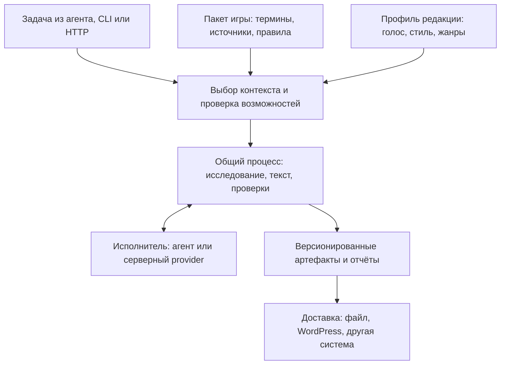

# Архитектура ManacostTeam для нескольких игр и способов запуска

Дата: 2026-10-13. Статус: проект архитектуры и начальный контракт контекста.
Выбор владельца: агентная установка и серверный запуск одинаково важны.

Обновление этапа 2: стиль Манакоста вынесен в `profiles/manacost/style.json` и
выбирается по умолчанию для всех шести игр. Общие жанры и игровые термины
разделены; автоматическая загрузка локализации новых игр пока не подключена.

Обновление этапа 1: `task_context` подключён к редакторским CLI/HTTP и Go
`/v2/edit`, переводческим `/prepare` и `/memory/approve` для Hearthstone/WoW.
Общий stdlib runtime находится в `shared/manacost_context.py` и включается в
переносимые навыки. [Текущий контракт, команды и ограничения](TASK_CONTEXT.md).
Редактор поддерживает Manacost; нейтральный профиль и полное выделение игровых
правил/авторских норм остаются следующими этапами. Описание этапа 0 ниже
сохранено как основание проектных решений.

## Цель и реализованная граница

Одни редакционные возможности должны работать с Hearthstone, League of Legends,
World of Warcraft, Deadlock, Overwatch и Heroes of the Storm. Игру, голос редакции,
способ выполнения и место доставки результата выбирают независимо.
Для задач вне игр игровой контекст отсутствует.

На этапе 0 были реализованы только каталоги игр/редакционных профилей и
stdlib CLI `tools/resolve_context.py`. Он возвращает проверенный JSON-контекст,
с версиями и хешами каталогов. `resolution_scope=metadata_only` означает:
контекст выбран, но workflow, игровые данные и runtime ещё не подключены.
Версии `0.1.0` относятся к записям конфигурации, а не к патчам игр.
Каталогизация игры не означает готовый переводчик, парсер или генератор гайдов.

Существующие skills, API, сборщик и release-пакеты продолжают использовать
прежние контракты. Ниже явно отделены текущая основа и будущая реализация.

## Что уже есть и что мешает расширению

| Наблюдение в исходниках | Архитектурное следствие |
| --- | --- |
| `teams/registry.json` и `tools/build_team_skills.py` уже задают ресурсы и воспроизводимую упаковку девяти навыков. | Развивать существующий сборщик; отдельный механизм упаковки не нужен. |
| `teams/manacost-publish/scripts/publish.py` запускает `editorteam.publication_run`; runner хранит этапы и отзывы, но не вызывает модели. | Журнал процесса можно использовать в обоих режимах, а исполнение модельных этапов требует отдельного адаптера. |
| `editor/go/internal/api/server.go` содержит `/v2/edit`; `translate/app/main.py` — отдельный FastAPI-сервис. | Сохранить работающие сервисы за адаптерами и общий контракт задачи. |
| `translate/app/main.py` ограничивает игру `wow\|hearthstone`; `glossary()` объединяет `*-names.en-ru.tsv`. | Выбирать терминологию по игре, продукту, сборке и языкам; проверять пересечения и неоднозначность имён. |
| `editor/src/editorteam/wordpress.py` объединяет HTML-экспорт, форматы Hearthstone и карточные шорткоды. | Отделить форматирование результата от распознавания игровых сущностей и настроек сайта. |
| EditorTeam-пакет включает корпус, стиль и голос Manacost; SVG-пакет включает игровые ассеты. | Авторский профиль и игровой пакет должны подключаться выборочно. |
| `XMLTeam` разбирает именно XML-реплеи Hearthstone. | Сохранить специализированный парсер; другие игры могут иметь совсем другой формат данных. |

Это выводы из чтения исходников, а не результат полного аудита сервисов или
проверки их production-развёртывания.

## Четыре независимые части



**Общие возможности.** Поиск доказательств, редактура, сегментация переводов,
проверка чисел и ссылок, план материала, журнал этапов и валидация артефактов.
Они получают игровой контекст явно. Карты, чемпионы, таланты, классы,
муллиган и матчапы не становятся обязательными понятиями общего процесса.

**Пакеты игр.** Подтверждённые термины и сущности, источники, правила свежести,
продукты/режимы, жанровые шаблоны и специальные адаптеры. Новый пакет сначала
может поддерживать только редактуру и исследование; наличие реплеев или статистики
декларируется отдельно после реализации и проверки. Источники и доступность API
для пяти новых игр пока не проверены; предполагаемые URL/эндпоинты не регистрируются.

**Редакционные профили.** Manacost, нейтральный профиль, позднее — другие
редакции и авторы. Профиль задаёт голос, оформление и правила жанра.
Личные корпуса и права на их распространение требуют отдельного выбора состава
пакета. Существующие `editor/СТИЛЬ.md` и `editor/ГОЛОС.md` сначала нужно разделить
на общие редакционные и Hearthstone-специфичные правила.

**Адаптеры среды и доставки.** Адаптер агента передаёт задания встроенной модели
и доступным инструментам; серверный адаптер вызывает явно настроенного provider.
WordPress получает готовый артефакт. Его категории, шорткоды и credentials относятся
к конфигурации конкретного сайта. Один пакет игры используется на разных сайтах.

## Расположение и зависимости

На первом этапе сохраняются `editor/`, `research/`, `translate/`, `svg/`,
`XMLTeam/`, `marketing/`, `job/`, `teams/` и `skills/`. Общие контракты описываются
в `docs/`, каталоги контекста находятся в `games/` и `profiles/`.

При фактическом выделении ресурсов появятся `games/<id>/` и `profiles/<id>/`.
Каталог `adapters/` понадобится при первом общем адаптере, `deploy/` — при
появлении общего Compose. Эти каталоги пока не созданы. Общий `core/` выделяется
только для кода с двумя реальными потребителями и тестами его контракта.

Правила зависимости:

1. Общая логика принимает нормализованные данные; не импортирует конкретную игру
   и не выбирает Hearthstone по умолчанию в новом контракте.
2. Игровые адаптеры преобразуют данные в общий контракт. `XMLTeam` сохраняет
   собственные lossless-типы; обобщаются только подтверждённые выходные факты.
3. Агент и HTTP вызывают один процесс и используют одинаковые правила проверок.
4. Skills описывают действия и используют проверяемые инструменты; не являются
   единственной реализацией серверной бизнес-логики.
5. Разные runtime связываются JSON/артефактами или существующими HTTP API.
   Python, Go и TypeScript не переписываются ради одного языка.

Для первого серверного пути предпочтителен небольшой дополнительный gateway
на уже используемом Go, работающий с существующими инструментами. Это проектное
решение, а не реализованный сервис. Сначала нужен вертикальный сценарий
«задача → проверенный артефакт → черновик WordPress».

## Контракт задачи и ресурсов

Реализованный пример выбора контекста:

```bash
python3 tools/resolve_context.py --game league-of-legends --profile manacost --execution agent
python3 tools/resolve_context.py --game world-of-warcraft --profile manacost --execution server
python3 tools/resolve_context.py --profile neutral --execution server
```

Последняя команда выбирает задачу вне игр. CLI можно вызывать из любой рабочей
папки по абсолютному пути; Python-пакеты дополнительно устанавливать не нужно.
Неизвестная игра/профиль, версия схемы или некорректный каталог дают ошибку.
`--patch` сохраняет предоставленное значение и не подтверждает его актуальность.
Выбор `server` не запускает сервер и не проверяет наличие provider.

Следующий контракт рабочего запуска должен включать:

| Поле/артефакт | Назначение |
| --- | --- |
| `schema_version`, `run_id`, `operation` | Версия контракта и идентичность задачи: edit, translate, research, article и т. п. |
| `game`, `profile`, `execution` | Независимые части реализованного контекста. |
| `game_context` | Продукт, режим, регион, языки, патч/сборка и период исследования, когда они применимы. |
| `resolved_resources` | Точные версии/хеши словарей, правил, шаблонов и адаптеров, использованных запуском. |
| `input_artifacts` | Исходники и полные источники с происхождением, временем получения и хешами. |
| `required_capabilities` | Нужные проверки, доступ к источникам и модельным этапам; проверяются до исполнения. |
| `output_artifacts` | Markdown, безопасный HTML, SVG или JSON, отчёты и их хеши. |
| `delivery` | Необязательная отдельно настроенная доставка результата. |

Языки и продукты обязательны там, где зависят термины; например, нельзя смешивать
разные продукты WoW в один безымянный словарь. Translation memory разделяется
по игре, продукту, паре языков и редакционному профилю. Термины имеют происхождение
и границы применимости; изменение пакета не подменяет ресурсы старого запуска.
Хеш нынешних каталогов фиксирует только метаданные, не будущие словари и ассеты.

Порядок настройки: общие значения → пакет игры → редакционный профиль →
параметры задачи. Инварианты целостности, доказательств и безопасности не
отключаются профилем. Игровой источник истины по именам имеет приоритет над
стилистическим предпочтением. Новые задачи выбирают игру явно либо `game=null`;
старые entrypoints сохраняют собственные defaults через адаптер совместимости.

## Два равноправных способа выполнения

**В агенте.** Устанавливаются выбранные skills, игровые ресурсы и профиль.
Агент выполняет модельные этапы собственными средствами. Отдельный API модели
не обязателен для существующего native процесса. Локальные инструменты сохраняют
артефакты и проверяют их форму/целостность.

**На сервере.** HTTP принимает задачу и возвращает ID; worker выполняет этапы,
а клиент получает статус и артефакты. Для генерации текста нужен настроенный
model provider; отсутствие provider допускает только детерминированные операции.
Установка skills сама по себе не превращает сервер в работающего ИИ-агента.

Существующий publication runner — основа журнала, но не готовая очередь сервера.
На первом серверном этапе достаточно одного worker и локального persistent volume:
атомарное сохранение, блокировка запуска, lease на исполнение, журнал завершённых
этапов, восстановление после перезапуска. Перед несколькими worker нужно выбрать
транзакционное хранилище и протестировать конкуренцию; Redis/Kubernetes заранее
не требуются. Бюджеты, таймауты и retries ограничиваются на уровне этапов.

Качество статьи и исполнение задачи — разные статусы. Статусы исполнения:
queued/running/waiting/blocked/failed/completed; `ready` относится к артефакту
после обязательных проверок, `delivered` — к подтверждённой доставке.
Изменение текста или evidence инвалидирует отзывы. Независимая проверка требует
отдельного модельного контекста; программная проверка JSON не заменяет её.

## Установка и обновление

Существующий сборщик остаётся источником воспроизводимых skill-пакетов.
Нужно добавить выбор навыков, игр, профилей и целевого клиента, затем включать
только необходимые ресурсы и их версии в manifest выпуска.

Будущий installer должен:

1. Проверять хеши пакета, пути распаковки и требуемые runtime; показывать dry-run.
2. Использовать проверенный для клиента формат установки и разрешать все ссылки
   внутри установленного пакета, без абсолютных путей исходной машины.
3. Сохранять manifest управляемых файлов. При локальном дрейфе останавливать
   обновление конкретного файла, сохраняя пользовательские изменения.
4. Собирать обновление в staging и переключать управляемую установку после
   проверки; сохранять предыдущую версию для отката.
5. Для сервера поднимать выбранные сервисы через Compose, с healthcheck и
   отдельным volume для задач/данных. Skills-only установка не требует Docker.

Точные команды установки и поддержка конкретных агентов появятся после
проверки их актуальных контрактов и smoke test на распакованных пакетах.
Нынешние каталоги не являются installer или готовыми game packs.

## WordPress и другие системы

Первый сценарий: запрос с сайта → серверная задача → артефакт с проверками →
HTML-экспорт → черновик WordPress. Редактор проверяет черновик перед публикацией.
Для начала достаточно REST-клиента; административный WordPress-плагин нужен,
когда потребуется интерфейс запуска/статуса внутри сайта.

WordPress предоставляет `POST /wp/v2/posts` и статус `draft`
([официальный контракт Posts](https://developer.wordpress.org/rest-api/reference/posts/)).
Для внешнего клиента доступны Application Passwords через HTTPS
([официальная документация authentication](https://developer.wordpress.org/rest-api/using-the-rest-api/authentication/)).
Используем отдельную учётную запись с нужными правами; ключи находятся в
серверной конфигурации, а не в игровых пакетах или модельном контексте.

HTML сначала очищается и валидируется. Шорткоды вставляет адаптер игры/сайта
только по подтверждённым сущностям; поддержка `hs_card` не наследуется LoL.
WordPress может менять HTML при сохранении: нужен тест чтения созданного
черновика, а не только успешный HTTP-ответ.

До записи сохраняются `run_id`, целевой сайт и хеш артефакта; после неё —
`post_id` и receipt. Стандартный REST create нельзя считать гарантированно
идемпотентным. При таймауте после отправки статус доставки становится unknown:
повторный create запрещён до сверки. Надёжный автоматический повтор потребует
подтверждённого механизма дедупликации на сайте. Обновление существующего материала
проверяет конфликт с ручной правкой и не перезаписывает её молча.

Другой CMS/бот/документ подключается отдельным delivery adapter и получает тот
же артефакт. Размещение API публично потребует аутентификации, проверки владельца
каждого run и ограничений доступа к источникам; для MVP gateway доступен приватно.

## Миграция по проверяемым этапам

| Этап | Изменения | Критерий приёмки |
| --- | --- | --- |
| 0 — реализован | Каталоги шести игр, двух профилей, context CLI и этот проект. | Выбор каждой комбинации agent/server; неизвестные значения отклоняются; задача вне игр не наследует Hearthstone. |
| 1 — общий контекст | Подключить context к edit/translate/publication через явные адаптеры; отделить термины, голос и источники. | Старые сценарии Hearthstone сохраняют результаты; новые запросы получают game/profile/resource versions; словари разных игр изолированы. |
| 2 — первая переносимость | WoW как первый второй домен: уже есть подготовка терминов; отдельно LoL, Deadlock, Overwatch, Heroes of the Storm. | Для каждой игры подтверждены источники и одна реальная редакционная задача; неподдерживаемые возможности возвращают понятную ошибку. |
| 3 — agent + server | Выборочная упаковка/installer и один серверный вертикальный сценарий разрабатываются на одном контракте. | Пакет работает вне checkout; сервер восстанавливает задачу после рестарта; одинаковый вход проходит одинаковые детерминированные проверки в обоих режимах. |
| 4 — WordPress | Общий HTML-экспорт и REST delivery adapter. | На тестовом сайте создаётся один черновик; неопределённый результат записи не порождает дубликат; шорткоды и сохранённый HTML проверены. |
| 5 — дополнительные задачи | SVG, marketing, hiring и специальные игровые данные подключаются по потребности. | Новая возможность не требует правки всех Teams; устанавливаются только выбранные зависимости. |

WoW предложен первым из-за существующего translation-контура; это не означает
готовность полного WoW-пакета. Приоритет следующих четырёх игр можно менять.
Переход каждого модуля выполняется отдельным изменением с его собственными
тестами, обновлением версий навыков и новым воспроизводимым выпуском при
изменении пакетов. Опубликованные архивы не переписываются.

## Проверка текущего этапа и открытые решения

```bash
python3 -m unittest discover -s tests -p 'test_context_resolution.py' -v
```

Эти тесты проверяют метаданные/CLI, версии и хеши, ошибки и отсутствие fallback.
Они не подтверждают работу игровых адаптеров, LLM, Docker или WordPress.

Проверка 2026-10-13: 7 новых тестов прошли. Общий root-прогон выполнил
21 тест, но setup класса portable runtime завершился ошибкой неизменяемости
`1.4.0/editor-team-1.4.0.zip`; `build_team_skills.py --check` падает по той же
причине. Ошибка воспроизведена на отдельной чистой копии исходного HEAD из
`git archive`, без новых файлов. Дрейф существующего выпуска требует отдельного
разбора; обход проверки и перезапись опубликованного архива не выполнялись.

До серверной реализации нужно определить целевой сервер и его ограничения,
provider/бюджет для автономной генерации и тестовый WordPress. До выпуска game
packs — подтвердить источники, лицензии ассетов/корпусов и игровые продукты/режимы.
Эти вопросы не мешают добавить общий контекст и сохранить совместимость.
